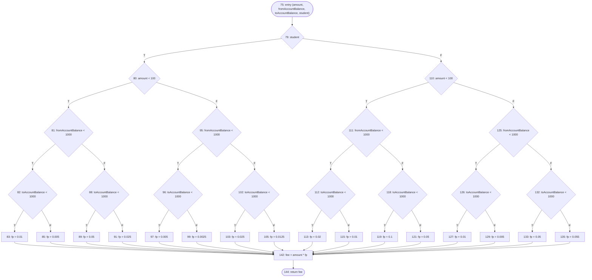

# CS 4472 Assignment 2: White-Box Testing

## Transfer fee (`FeesCalculator.calculateTransferFee`): basis path testing

### Control-flow graph

Each node is named by its line number in `src/main/java/bank/utils/FeesCalculator.java`.
Comments, blank lines and closing braces are not nodes. Line 77 (`double feePercentage;`) only
declares a variable, so it is part of the entry node 75. `fp` stands for `feePercentage`.
`T` and `F` mark the true and false edges of each decision.
A zoomable copy of the same graph is in [transfer-cfg.svg](transfer-cfg.svg).

### Cyclomatic complexity

| Method | Count | V(G) |
|---|---|---|
| Edges and nodes | E = 48, N = 34 (1 entry, 15 decisions, 16 assignments, 142, 144) | E − N + 2 = 48 − 34 + 2 = **16** |
| Decisions | P = 15 binary decisions (lines 79, 80, 81, 82, 88, 95, 96, 102, 110, 111, 112, 118, 125, 126, 132) | P + 1 = **16** |
| Regions | 15 enclosed regions (one per decision) + 1 outer region | **16** |

So there are 16 linearly independent basis paths. Because the decisions form a tree with no loops,
each basis path ends in a different assignment node (83 … 135).
